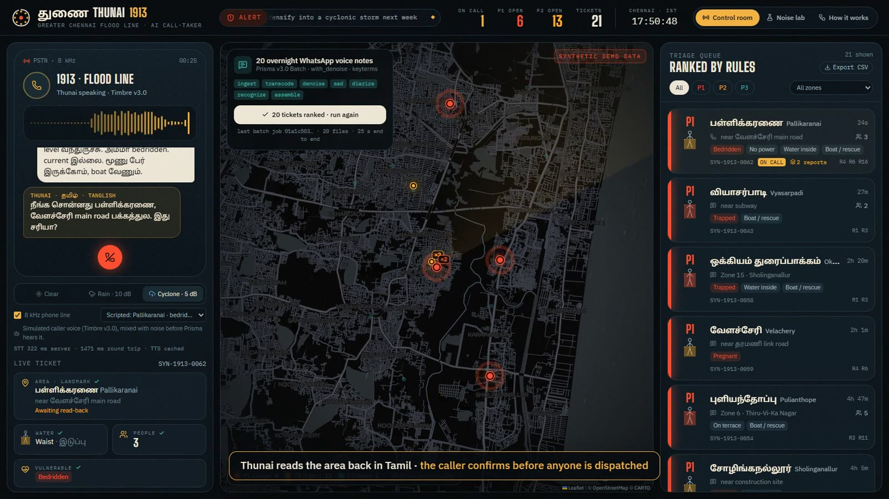
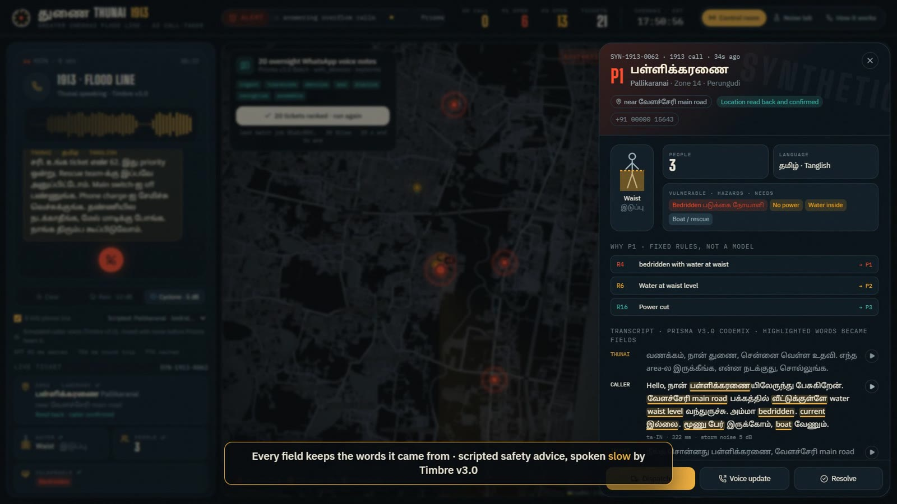
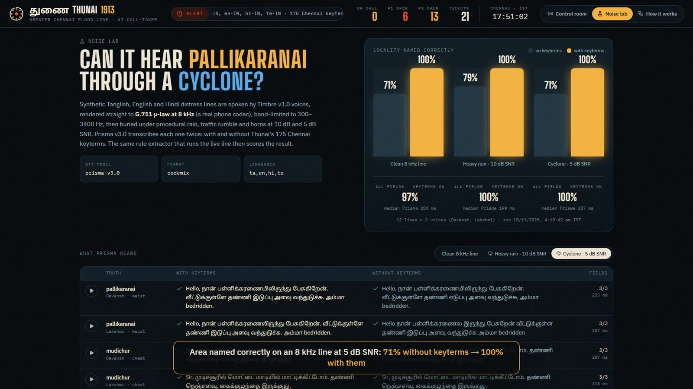
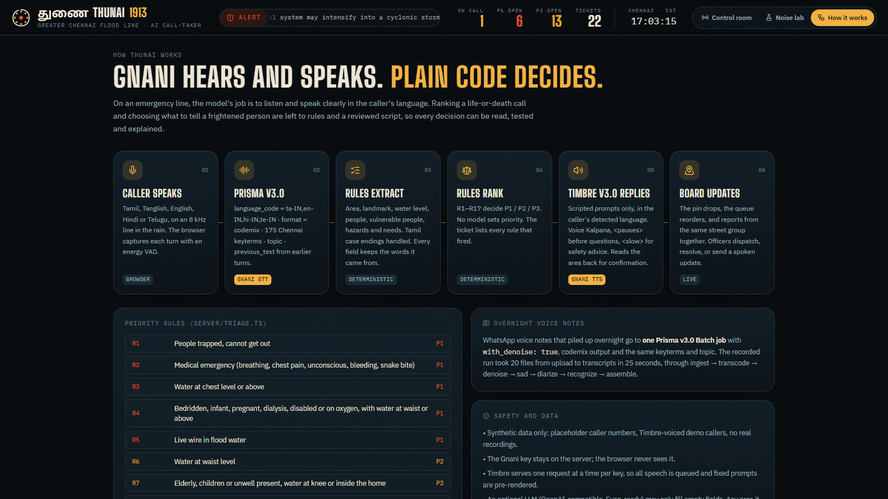

# துணை Thunai 1913

**A Tanglish voice call-taker and triage board for Chennai's flood helpline.**
When the 1913 lines are full, Thunai answers. Callers can speak Tamil, Tanglish, English, Hindi or Telugu over a bad phone line in the rain. Thunai turns the call into a structured ticket, reads the location back for confirmation, and places the ticket on a live map that Corporation staff work from.

Built for the Gnani AI **Great Indian AI Internship Challenge 2026**. `#GnaniAI` `#GreatIndianAIInternshipChallenge`

| | |
|---|---|
| 🌐 **Live demo** | **[thunai-ciw4.onrender.com](https://thunai-ciw4.onrender.com)** (free tier: the first visit can take about 50 s to wake up) |
| 🎬 **Demo video and assets** | [Google Drive folder](https://drive.google.com/drive/folders/13rj2HHqaVP4-oc30cbAMGWwxoX3FEACH?usp=drive_link) |
| 📄 **Solution pitch** | [docs/Thunai_1913_Solution_Pitch.pdf](docs/Thunai_1913_Solution_Pitch.pdf) |
| 🧭 **How it works** | [thunai-ciw4.onrender.com/how](https://thunai-ciw4.onrender.com/how) |
| 🧪 **Noise lab** | [thunai-ciw4.onrender.com/lab](https://thunai-ciw4.onrender.com/lab) |

> **Synthetic demo data only.** No real callers, phone numbers, recordings, Aadhaar, PAN or account details appear anywhere. Caller numbers are `+91 00000 xxxxx` placeholders, and every demo voice is a Timbre voice.



---

## Try it in two minutes

1. Open the [live demo](https://thunai-ciw4.onrender.com) on a laptop. The board opens with the 20 overnight voice notes already ranked. Click **Triage the backlog** to watch the Batch results land again.
2. In the caller dropdown, pick **Scripted: Pallikaranai · bedridden mother**, choose **Cyclone · 5 dB**, then click **Answer overflow call**.
   - Or keep **Caller: live microphone** and speak Tamil, Tanglish, English or Hindi yourself. Give an area, the water level and who is with you.
3. Watch the transcript come back in Tamil script with English in Latin. The fields fill in, Thunai reads the area back, and a P1 pin drops.
4. Click the ticket to see the words that became fields and the rules that set the priority. Then open **Noise lab** and **How it works**.

## Why

- Cyclone Murasu hit Chennai on 1–2 November 2026, and a Bay of Bengal system may become a cyclonic storm next week.
- On a normal day the Greater Chennai Corporation 1913 helpline takes about 2,000 calls. During Cyclone Michaung it logged 7,129 complaints in two days, and residents complained the hotline was overloaded.
- In a flood, the calls that matter most are the hardest to handle. A frightened caller in waist-deep water, speaking Tanglish on a phone with rain hammering the roof, has to name an area like *Pallikaranai* or *Okkiyam Thoraipakkam* clearly enough for someone to find them.

## What it does

| Surface | What happens |
|---|---|
| **Live call** (`/`) | Thunai greets the caller in Tamil. Each caller turn goes to **Prisma v3.0** with four candidate languages, `codemix` output and 175 Chennai keyterms. Fixed rules pull out the area, landmark, water level, number of people, vulnerable people, hazards and needs. Thunai asks only for what's missing, **reads the area back for confirmation**, then closes with a ticket number and fixed safety advice in the caller's language, spoken by **Timbre v3.0**. |
| **Triage board** | A dark map of Chennai with pins coloured by priority, plus a queue sorted by fixed rules. Reports from the same street are grouped. Each ticket shows the code-mixed transcript with the words that became fields highlighted, the rules that fired, and audio playback. Officers can dispatch, resolve, or send a spoken status update in the caller's language. |
| **Overnight voice notes** | 20 synthetic WhatsApp voice notes go to **one Prisma v3.0 Batch job** with `with_denoise`, `keyterms` and `topic`. The board fills with ranked tickets. Measured: 20 files, 25 s end to end. |
| **Noise lab** (`/lab`) | Measures whether place names survive a phone line in a storm (results below). |
| **How it works** (`/how`) | The pipeline, every priority rule, the keyterms sent to Prisma, and the safety boundaries, on one page for reviewers. |
| **Export** | `Export CSV` on the queue (or `GET /api/tickets.csv`) downloads the ranked queue for field teams, labelled synthetic. |

| Ticket: evidence and rules | Noise lab |
|---|---|
|  |  |

### Model proposes, code decides

- Everything Thunai **says** comes from a reviewed script in `server/script.ts`, in 4 languages. Nothing spoken on an emergency line is generated by a model.
- **Priority** comes from plain rules in `server/triage.ts`, for example *R4: bedridden, infant, pregnant, dialysis or oxygen with water at waist level or above → P1*. Every ticket lists the rules that fired.
- **Extraction** in `server/extract.ts` is deterministic and records its evidence. It handles Tamil case endings (தாம்பரம் → தாம்பரத்துல, கொளத்தூர் → கொளத்தூரில்) and Hindi/Telugu spellings of place names, and keeps "chest pain" (a medical emergency) apart from "chest-level water".
- An optional LLM (any OpenAI-compatible endpoint: Groq, Gemini, or Evon served with vLLM) can fill fields the rules missed. Any area it proposes must exist in the gazetteer, and it never sets priority. It is off by default.



## Gnani AI technology used

| Model / API | Where | Settings |
|---|---|---|
| **Prisma v3.0**, REST `POST /stt/v3` | every caller turn | `model=prisma-v3.0`, `language_code=ta-IN,en-IN,hi-IN,te-IN`, `format=codemix`, `keyterms` (175 Chennai areas and flood terms), `topic`, `previous_text` (earlier turns of the same call) |
| **Prisma v3.0**, Batch `POST /stt/v3/batch/jobs` | overnight voice notes | `with_denoise: true`, `format: codemix`, `keyterms` + `topic`, per-segment language |
| **Timbre v3.0**, REST `POST /api/v1/tts/inference` | every Thunai reply, status call-backs, scripted demo callers | voice `Kalpana`, audio tags `<pauses>` and `<slow>`, language set from Prisma's `detected_language_code`; other v3.0 voices play the simulated callers |
| **Timbre v3.0**, `container: mulaw` | noise lab | G.711 µ-law at 8 kHz, a real telephone codec |
| **Evon v3.3** | optional | Evon isn't on the API platform yet. `LLM_BASE_URL` can point at a vLLM-hosted Evon with no code change |

## Noise lab results

Setup: 12 synthetic distress lines (Tanglish, English, Hindi) × 2 Timbre v3.0 voices, rendered as µ-law 8 kHz and band-limited to 300–3400 Hz. Procedural rain, traffic rumble and horns are mixed in at 10 dB and 5 dB SNR. Prisma v3.0 transcribes each clip once with and once without keyterms, and the live extractor scores the result.

| Line condition | Area correct, no keyterms | Area correct, **with keyterms** | All fields, with keyterms | Median Prisma time |
|---|---|---|---|---|
| Clean 8 kHz | 71% | **100%** | 97% | 206 ms |
| Heavy rain, 10 dB | 79% | **100%** | 100% | 199 ms |
| Cyclone, 5 dB | 71% | **100%** | 100% | 207 ms |

Caveats:
- Timbre voices are cleaner than a frightened human, so treat these as upper bounds.
- 24 clips per condition is a small set.
- Two of the original requests hit HTTP 429 and were re-run, since they are infrastructure failures rather than recognition results.

Re-run with `npm run eval`. To rescore saved transcripts without new API calls: `npx tsx scripts/eval-noise.ts --rescore`.

## Run it locally

Requirements: Node.js 20+ and a Gnani API key from [app.gnani.ai/voice](https://app.gnani.ai/voice).

```bash
git clone https://github.com/Shyamistic/Thunai.git && cd Thunai
npm install
cp .env.example .env   # set GNANI_API_KEY (server only) and, optionally, VITE_CARTO_KEY (dark map tiles)
npm run dev            # API on :8787, UI on http://localhost:5173
npm test               # 15 tests: extraction, Tamil case endings, priority rules, call flow
```

Without `VITE_CARTO_KEY`, the map falls back to Esri's dark gray canvas, which needs no key.

In the UI, pick **Caller: live microphone** to speak yourself, or a **Scripted** caller for a repeatable demo. Use **Clear / Rain 10 dB / Cyclone 5 dB** and **8 kHz phone line** to choose what Prisma hears.

### Hosting

The live demo runs on Render from the `Dockerfile` (`render.yaml` describes the same service for a native Node runtime).

- Environment variables:
  - `GNANI_API_KEY`: server only; it never reaches the browser.
  - `VITE_CARTO_KEY`: a browser tile key, so it is included in the page bundle.
  - `PUBLIC_DEMO=1`
- `PUBLIC_DEMO=1` protects the programme credits:
  - per-visitor limits: 8 calls, 50 turns, 10 voice updates and 6 backlog replays per 10 minutes
  - live Batch runs turned off (the recorded job is replayed instead)
  - the board is seeded with the voice-note backlog on start
- HTTPS is required for microphone access.

### Scripts

```bash
npm run voicenotes     # render the 20 synthetic voice notes (Timbre v3.0 + storm noise)
npm run backlog        # send them through one Prisma v3.0 Batch job and cache the transcripts
npm run eval           # the noise lab (about 150 short Prisma calls)
npx tsx scripts/sim-call.ts           # a full noisy phone call against the API, no browser needed
npx tsx scripts/e2e.ts pallikaranai   # drive the real UI in local Chrome and save screenshots
npx tsx scripts/make-video.ts         # record the 60 s demo video with sound → video/thunai-1913-demo.mp4
npx tsx scripts/og-card.ts            # render the link-preview card → public/og.jpg
```

`make-video.ts` drives the real app in headless Chrome with a scripted caller and on-screen captions, and logs when each clip starts. It then rebuilds the soundtrack from those exact clips (the caller on a phone-band line under storm noise, Thunai clean, a rain bed throughout) and trims network waits between turns to about 1 s.

## Engineering notes

- **One TTS request at a time.** Timbre can return `429 RATE_LIMITED` ("Only 1 active request is allowed at a time"), so all synthesis runs through a single promise queue with backoff. Fixed prompts are pre-rendered at startup and cached on disk, so a live call only waits on the dynamic lines (read-back and close).
- **Candidate languages over bare `indic-auto`.** A list of four likely languages is more reliable than open detection, and the reply language follows `detected_language_code`. A two-word "yes" can't switch the call's language.
- **Keyterms decide the script.** With a Latin keyterm such as `Pallikaranai`, codemix output writes the place in Latin, which is easier to match and display.
- **Multipart detail for Batch.** Node's `FormData` sends a `Blob` as a file part, and the API returned 500 for that. `config` has to be a plain string field.
- **Realtime vs REST.** This build uses REST turns: the browser captures the caller with an energy VAD and sends each utterance. That keeps Prisma's `topic` and `previous_text` available (Realtime accepts only `keyterms`), and lets the demo mix storm noise into exactly what Prisma hears. The cost is no barge-in: the caller can't interrupt Thunai mid-sentence.

## Project layout

```
server/   index.ts (API) · gnani.ts (Prisma/Timbre/Batch clients) · extract.ts · triage.ts · script.ts · call.ts · gazetteer.ts · backlog.ts
src/      React app: control room, map board, queue, ticket drawer, noise lab, how-it-works
tests/    node:test suites for extraction, triage and the call flow
scripts/  voice-note generation, batch run, noise eval, browser e2e, demo video, OG card
data/     backlog/ (synthetic voice notes + recorded Batch result) · eval/ (noise-lab audio + results)
docs/     solution pitch and screenshots
```

## Limitations

- Not connected to any emergency service, and not a replacement for one. A real deployment would need GCC's ward data, a telephony trunk (SIP/Exotel), human supervision on every P1, and native-speaker review of the Hindi and Telugu scripts.
- Coordinates are neighbourhood centroids from a hand-built gazetteer of about 100 areas. There is no street-level geocoding.
- The Telugu and Hindi prompts have not been reviewed by native speakers.
- Very short Hindi phrases on this Tamil-first line can come back in Tamil script ("मुझे मदद करो" → "முஜே மதத்துரோ"). Longer sentences are detected correctly.
- Calls abandoned without "End call" are closed automatically after 3 minutes of silence.
- Tickets are kept in memory and in a local JSON file, which is fine for a demo but not durable storage. On the free hosting tier they reset whenever the instance restarts.

## Credits

React, Vite, Tailwind CSS, Motion, Leaflet and react-leaflet, Lucide icons, Fontsource fonts (Big Shoulders Display, IBM Plex, Noto Sans Tamil/Devanagari/Telugu). Map tiles © CARTO and OpenStreetMap contributors (Esri fallback). Speech by Gnani AI.

[MIT licence](LICENSE).
